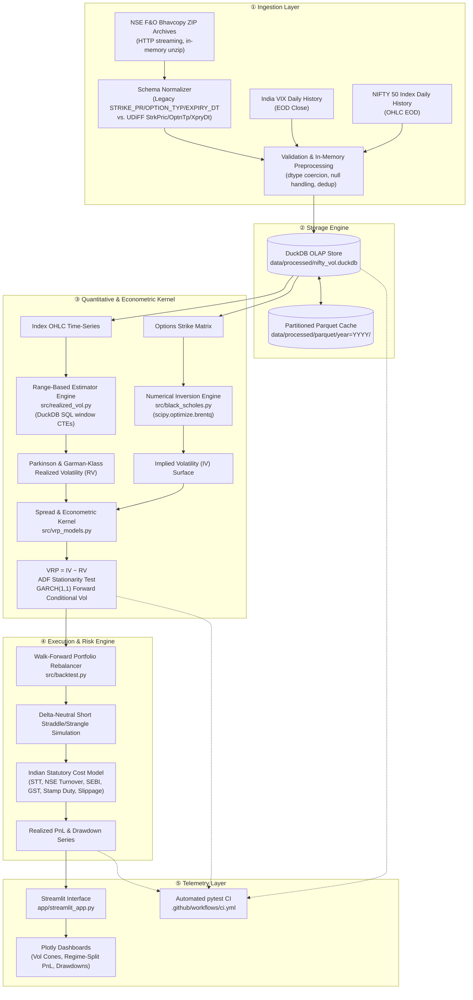

# System Architecture — `nifty-vol-risk-premium`

> **⚠️ LIVING DOCUMENT PROTOCOL**
> This document is the single source of truth for system topology. It **MUST be updated in the same commit/PR** whenever:
> - The data flow between layers changes (new ingestion source, new processing stage, new sink)
> - Module boundaries change (a file is split, merged, renamed, or moved between `src/`, `app/`, `sql/`)
> - Database schemas, table names, or Parquet partition keys change
> - The directory tree changes (new top-level folder, renamed package, new config file)
>
> Stale architecture docs are treated as a **P0 defect**. Any PR that changes system structure without a corresponding diff to this file should be blocked in review.

---

## 1. System Flow (Mermaid)



---

## 2. Current Directory Tree

> This tree reflects the repository **as it actually exists right now**, not the target end-state. New top-level folders and files from the full design above (`src/`, `app/`, `sql/`, `data/`, `AI_CONTEXT/`, `.github/`, etc.) are added incrementally as each piece of the pipeline in §1 is actually built, and this section is updated in the same commit each time (per the Living Document Protocol above).

```
nifty-vol-risk-premium/
├── AI_CONTEXT/
│   ├── ARCHITECTURE.md             # this file
│   ├── MAJOR_DECISIONS.md          # ADR log
│   ├── SECURITY.md                 # security & anti-hallucination protocol
│   ├── SRS.md                      # IEEE 830 requirements spec
│   └── TECH_SPECS.md               # technical + domain specs
├── sql/
│   └── schema.sql                  # DDL for index_eod + options_eod
├── src/
│   ├── __init__.py
│   ├── config.py                   # paths, .env loading, data dir creation
│   ├── database.py                 # DuckDB connection, init_db, query_df
│   └── black_scholes.py            # pricing, vega, bounded IV inversion
├── tests/
│   ├── test_smoke.py               # placeholder smoke test
│   ├── test_black_scholes.py       # parity, IV round-trip, boundary guards
│   └── test_database.py            # schema init + parameterized Arrow→Pandas
├── data/                            # gitignored; created at import by src/config.py
│   ├── raw/
│   └── processed/                  # nifty_vol.duckdb lives here
├── .venv/                           # gitignored; Python 3.11 virtualenv
├── conftest.py                      # puts repo root on sys.path for tests
├── requirements.txt                 # exact pins per SECURITY.md 2.4
├── .gitignore
└── LICENSE
```

---

## 3. Data Contracts

| Provider Module | Consumer Module | Data Contract Schema |
|---|---|---|
| `src/ingest.py` (NSE Bhavcopy stream) | `src/schema_normalizer.py` | Raw DataFrame: columns vary by era — Legacy (`STRIKE_PR: float`, `OPTION_TYP: str['CE','PE']`, `EXPIRY_DT: str`, `CLOSE: float`, `OPEN_INT: int`, `CONTRACTS: int`) or UDiFF (`StrkPric: float`, `OptnTp: str`, `XpryDt: str`, `ClsPric: float`, `OpnIntrst: int`, `TtlTradgVol: int`). Invariant: exactly one schema family per file. |
| `src/schema_normalizer.py` | `data/processed/nifty_vol.duckdb` (table `options_eod`) | Normalized schema (see `sql/schema.sql`): `trade_date DATE`, `expiry_date DATE`, `symbol VARCHAR`, `strike DOUBLE`, `option_type VARCHAR(2)` ∈ `('CE','PE')`, `open DOUBLE`, `high DOUBLE`, `low DOUBLE`, `close DOUBLE`, `settle_price DOUBLE`, `volume BIGINT`, `open_interest BIGINT`, `underlying_close DOUBLE`, `implied_vol DOUBLE`. `PRIMARY KEY (trade_date, expiry_date, symbol, strike, option_type)`. Invariant: `expiry_date >= trade_date`; `strike > 0`. `implied_vol` is `NULL` until populated by `src/black_scholes.py`. |
| `data/processed/nifty_vol.duckdb` (table `index_eod`) | `src/realized_vol.py` | Normalized schema (see `sql/schema.sql`): `symbol VARCHAR`, `trade_date DATE`, `open DOUBLE`, `high DOUBLE`, `low DOUBLE`, `close DOUBLE`, `volume BIGINT`. `PRIMARY KEY (symbol, trade_date)`. Invariant: `low <= open,close <= high`; dates strictly increasing, no gaps > 7 calendar days (holiday-tolerant). |
| `src/realized_vol.py` | `src/vrp_models.py` | `rv_series`: `trade_date DATE`, `rv_close_to_close DOUBLE`, `rv_parkinson DOUBLE`, `rv_garman_klass DOUBLE` (all annualized, non-negative or `NaN`). Invariant: computed strictly from `trade_date - 30 <= t <= trade_date` (no look-ahead). |
| `src/black_scholes.py` | `src/vrp_models.py` | `iv_surface`: `trade_date DATE`, `strike DOUBLE`, `expiry_date DATE`, `option_type VARCHAR`, `implied_vol DOUBLE` (`NaN` on inversion failure or intrinsic-value violation), `moneyness DOUBLE`. Invariant: `sigma_min=1e-4 <= implied_vol <= sigma_max=4.0` or `NaN`. |
| `src/vrp_models.py` | `src/backtest.py` | `vrp_signal`: `trade_date DATE`, `iv_atm DOUBLE`, `rv_forward_30d DOUBLE`, `vrp DOUBLE`, `adf_pvalue DOUBLE`, `garch_forecast_vol DOUBLE`. Invariant: `vrp = iv_atm - rv_forward_30d`; all fields computed only from data where `date <= t`. |
| `src/backtest.py` | `app/streamlit_app.py` | `backtest_results`: `trade_date DATE`, `position_type VARCHAR`, `pnl DOUBLE`, `cumulative_pnl DOUBLE`, `drawdown DOUBLE`, `sharpe DOUBLE`, `sortino DOUBLE`, `max_drawdown DOUBLE`. Invariant: `cumulative_pnl` is monotonically defined (no gaps); costs already net of PnL. |
